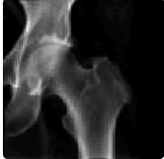
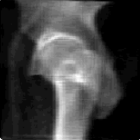
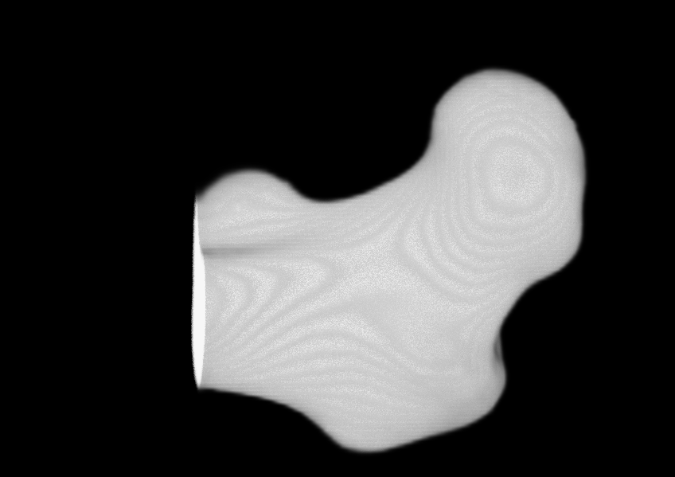

# X-Ray to 3D Reconstruction

## Visualization

  
  
  

  <em>Multi-view X-ray inputs (AP and Lateral views) and resulting 3D reconstruction</em>

## Overview

**X-Ray to 3D Reconstruction** is a deep learning-based project that reconstructs 3D anatomical models from multi-view 2D X-ray images. The system focuses on medical imaging applications for femur, hip, and vertebra reconstruction using state-of-the-art deep learning architectures.

## Project Structure

- **AI/** - Machine learning pipeline for 3D reconstruction
  - `dataset/` - Patient X-ray and CT data storage
  - `drr-preprocessing/` - Digitally Reconstructed Radiograph (DRR) generation tools
  - `training_femur_hip/` - Model training for femur and hip reconstruction
  - `training_vertebra/` - Model training for vertebra reconstruction
  - `inference/` - Trained model inference scripts
  - `notebooks/` - Jupyter notebooks for experimentation

- **frontend/** - Web interface for the reconstruction system
  - Built with Next.js 15.5 and TypeScript
  - User interface for uploading multi-view X-rays
  - Interactive 3D visualization using NiiVue

## Datasets

The project utilizes the following medical imaging datasets:

- **CTpelvic1K** - Hip structures extracted for pelvic reconstruction
- **TotalSegmentator** - Hip and femur structures used for comprehensive anatomical modeling
- **VerSe19** - Vertebrae segmentation dataset for spine reconstruction

## Models

### Architecture

- **SwinX2S (Swin Transformer X2-Small)** - For femur and hip reconstruction
  - Hierarchical vision transformer with shifted windows
  - Efficient multi-scale feature extraction
  - Optimized for medical imaging tasks

- **TransVert** - For vertebra reconstruction
  - CNN-based encoder-decoder architecture
  - Specialized for spinal structure modeling
  - Efficient 3D reconstruction from 2D projections

Both models were trained and compared using PyTorch Lightning framework on NVIDIA A100 GPU (80GB VRAM).

## Preprocessing Pipeline

### DRR (Digitally Reconstructed Radiograph) Generation

The preprocessing pipeline generates synthetic multi-view X-ray images from CT scans:

1. **CT Loading** - Load CT volumes in DICOM/NIfTI format
2. **DRR Synthesis** - Generate multi-view 2D X-ray projections from 3D CT data
   - GPU-accelerated ray-casting
   - Simulates real X-ray physics
   - Multiple viewing angles (required for reconstruction)
3. **Dataset Preparation** - Organize paired multi-view DRR-CT data for model training

The DRR preprocessing is built with C++ and CUDA for efficient GPU computation.

**Note**: No segmentation or data augmentation was applied during preprocessing.

## Training

- **Femur & Hip Training**: SwinX2S model trained on CTpelvic1K (hip) and TotalSegmentator (hip and femur)
- **Vertebra Training**: TransVert model trained on VerSe19 dataset
- Both models use paired multi-view DRR-CT data for supervised learning
- Training performed using PyTorch Lightning on NVIDIA A100 GPU (80GB VRAM)
- Model performance comparison conducted between SwinX2S and TransVert architectures

## Inference

The inference pipeline reconstructs 3D models from multi-view X-ray images:

1. **Multi-view Input** - Accept multiple X-ray views (minimum 2 views required)
2. **Image Preprocessing** - Normalize and resize input X-rays to model requirements
3. **Feature Extraction** - Extract features from each view using trained models
4. **3D Reconstruction** - Generate volumetric output by fusing multi-view features
5. **Post-processing** - Refine mesh geometry and apply surface smoothing
6. **Visualization** - Render 3D models for clinical review

## Frontend Features

- **3D Visualization**: Interactive medical imaging viewer using NiiVue
- **Multi-view Upload**: Support for uploading multiple X-ray views
- **Real-time Rendering**: Display reconstructed 3D models in NIfTI format
- **User Authentication**: Secure access with Clerk authentication
- **Export Options**: Download 3D models in STL/OBJ formats

## Key Features

- Generate synthetic multi-view X-rays (DRRs) from CT scans
- Train and compare deep learning models (SwinX2S vs TransVert)
- Reconstruct 3D models from multi-view 2D X-ray images
- Web-based interface with NiiVue for 3D visualization
- Support for multiple anatomical regions (femur, hip, vertebra)
- GPU-accelerated preprocessing and inference
- Model training with PyTorch Lightning framework

## Getting Started

### Prerequisites

- Python 3.8+
- CUDA-capable GPU (NVIDIA A100 80GB recommended for training)
- Node.js 18+ (for frontend)
- PyTorch with CUDA support
- PyTorch Lightning

### AI Pipeline Setup

1. Navigate to the AI directory
2. Install Python dependencies (PyTorch, Lightning, CUDA toolkit)
3. Prepare multi-view DRR dataset using preprocessing tools
4. Train models using Lightning framework on A100 GPU
5. Run inference with multi-view X-ray inputs

### Frontend Setup

1. Navigate to the frontend directory
2. Install dependencies with `npm install`
3. Configure environment variables (Clerk keys, API endpoints)
4. Run development server with `npm run dev`
5. Upload multi-view X-rays and visualize reconstructions with NiiVue

## Applications

- Medical imaging and diagnosis
- Pre-surgical planning and simulation
- Patient-specific implant design
- Medical education and training
- Clinical decision support systems
- Research and development in medical imaging

## Contributors

- **Jeevan Neupane** - AI Development
- **Anil Shrestha** - AI and Frontend Development
- **Nabin Ranabhat** - AI and Frontend Development

